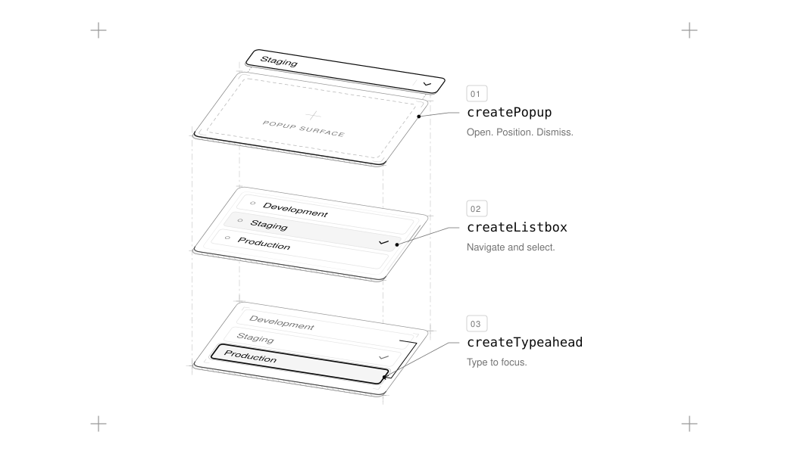

# UI SDK

A library of UI behaviors for building interfaces: keyboard navigation, focus, selection, dismissal, popups, drag and drop and the ARIA they need, in `@ui-sdk/core`, with adapters for React, Vue, web components, Solid and Svelte.

<picture>
  <source media="(prefers-color-scheme: dark)" srcset="./assets/behaviors-dark.svg">
  
</picture>

## Example

Let's build a popover. `createPopup` gives it everything a popover needs: it opens from a button, sits next to it, closes on Escape or a click outside, and moves focus in and back.

Define it once in `invite.ts`:

```ts
import {
  createPopup,
  definePrimitive,
  popupClose,
  popupContent,
  popupState,
  popupTrigger,
} from "@ui-sdk/core"
import { popoverPreset } from "@ui-sdk/core/popover"

const invite = definePrimitive({
  name: "invite",
  options: { defaultOpen: "boolean" },
  state: (options: { defaultOpen?: boolean }) => popupState(options),
  api: (context) => createPopup(context, { preset: popoverPreset }),
  slots: (slot) => ({
    trigger: popupTrigger(slot),
    content: popupContent(slot),
    close: popupClose(slot),
  }),
})

export { invite }
```

Then use `createParts` to turn it into components. In React:

```tsx
import { createParts } from "@ui-sdk/react/primitive"
import { invite } from "./invite"

const { Root, Trigger, Content, Close } = createParts(invite, {
  trigger: "button",
  content: "div",
  close: "button",
})

function InvitePopover() {
  return (
    <Root>
      <Trigger>Invite</Trigger>
      <Content>
        <p>Anyone with the link can join.</p>
        <Close>Done</Close>
      </Content>
    </Root>
  )
}

export { InvitePopover }
```

And in Vue, it's the same call with the same parts:

```vue
<script setup lang="ts">
import { createParts } from "@ui-sdk/vue/primitive"
import { invite } from "./invite"

const { Root, Trigger, Content, Close } = createParts(invite, {
  trigger: "button",
  content: "div",
  close: "button",
})
</script>

<template>
  <Root>
    <Trigger>Invite</Trigger>
    <Content>
      <p>Anyone with the link can join.</p>
      <Close>Done</Close>
    </Content>
  </Root>
</template>
```

The behavior lives in `invite.ts`, so both popovers open, close and move focus the same way. Style them with your own classes, using the data attributes each part sets, like `data-open`.

## Contributing

Contributions are welcome. See [contributing](./contributing) to get the repo
running locally and land a change, and use
[issues](https://github.com/vercel-labs/ui/issues) for issues. By
participating, you agree to our [Code of Conduct](CODE_OF_CONDUCT.md).

## Security

Please do not open public issues for security vulnerabilities. Instead, follow
[SECURITY.md](SECURITY.md) and report responsibly to
[responsible.disclosure@vercel.com](mailto:responsible.disclosure@vercel.com).

## Beta terms

UI SDK is currently in beta and subject to the [Vercel beta terms](https://vercel.com/docs/release-phases/public-beta-agreement);
the framework, APIs, documentation, and behavior may change before general availability.
